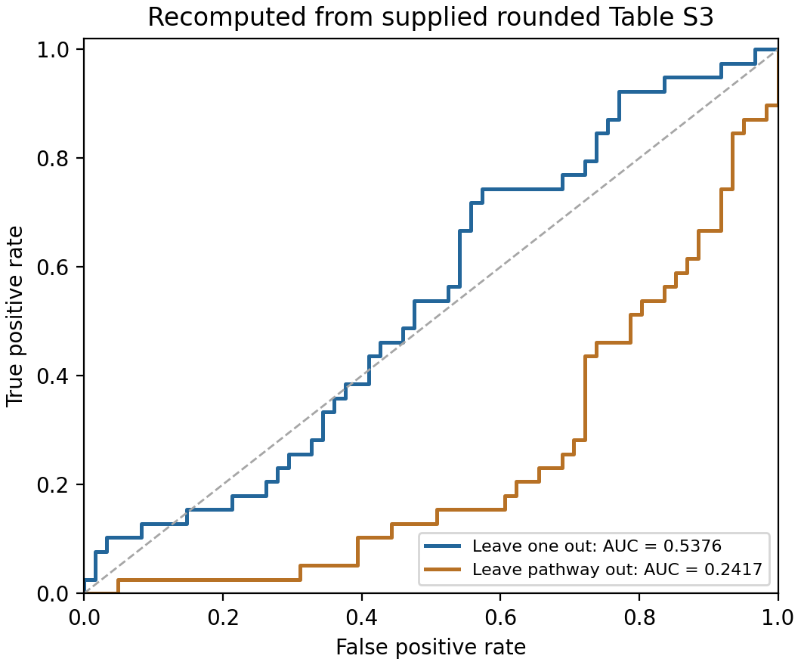

# Enzyme Assembly Recompute

[简体中文](README.md) · [Biological background (中文)](docs/biological_background.md) · [Usage](docs/usage.md) · [Methods](docs/methods.md) · [Reproducibility](REPRODUCIBILITY.md)

**A Python analysis workflow for membraneless-organelle research that tests whether sequence-derived features predict metabolic protein assembly labels.** It reads an existing feature table and binary reference labels, fits a supervised classifier, and evaluates held-out predictions and statistical evidence.

## Biological question

Membraneless organelles concentrate selected molecules without a surrounding lipid membrane. Liquid–liquid phase separation (LLPS), in which a concentrated phase coexists with a dilute phase, can contribute to the formation of some such compartments. Metabolic enzymes can also form or participate in intracellular assemblies, connecting protein-assembly studies with this field. Experimental examples and background references are provided in the [biological background document (中文)](docs/biological_background.md).

The computational question is specific: **under the supplied data and validation design, can 14 precomputed features describing protein length, charge, low complexity, disorder proxies, and related properties distinguish assembly-positive from assembly-negative metabolic proteins?**

| Element | Meaning in this workflow |
|---|---|
| Sample | One protein entry; the 100 entries are not 100 organelles or assembly mechanisms |
| Features | Fourteen numeric descriptors per protein, not fourteen enzyme types or an organelle sequence |
| Positive label | A source assembly annotation covering LLPS, filaments, amyloids, or oligomers; it may indicate participation in an assembly |
| Negative label | The source negative annotation, not a demonstration of inability to assemble under every condition |
| Main output | Held-out scores, ROC AUC, permutation p-values, and a conditional bootstrap interval |
| Intended use | Audit the predictive information of these descriptors and labels, informing subsequent feature and experimental design |

The target is a broad assembly annotation. Positive entries are not uniformly verified LLPS drivers or membraneless organelles. Scores are not calibrated intracellular LLPS probabilities. The workflow starts from feature CSVs; it does not generate sequence features, molecular structures, MD trajectories, catalytic functions, or metabolic fluxes.

The reference dataset contains 100 protein entries, 14 features, 39 positive labels, and 61 negative labels. Feature values retain the three-decimal display in the source manuscript's supplementary Table S3. Current results differ from manuscript values; see [REPRODUCIBILITY.md](REPRODUCIBILITY.md).

## Analysis workflow

1. Validate feature columns, counts, labels, finite values, and pathway groups.
2. Fit L2-regularized logistic regression with training-fold-only standardization.
3. Pool leave-one-out scores: each reference protein is scored by a model fitted to the other 99. Optionally repeat validation with entire pathways held out.
4. Repeat training under shuffled labels for a permutation test; resample fixed held-out label-score pairs within each class for a conditional bootstrap interval.
5. Export predictions, model parameters, and figures; reconstruct individual scores and run supplementary pathway-aggregate and feature analyses.

Training learns scaling parameters, an intercept, and feature weights. Cross-validation evaluates their predictions on held-out proteins. Equations and statistical conventions are documented in [Methods](docs/methods.md).

## Installation

Python 3.12 is the supported reference environment. Dependencies are NumPy, SciPy, and Matplotlib. Run commands from the repository root:

```bash
python3 -m venv .venv
./.venv/bin/python -m pip install --upgrade pip
./.venv/bin/python -m pip install -r requirements-tested.txt
```

Native Windows and Ubuntu-specific setup instructions are available in the [installation guide](docs/installation.md).

## Quick start

The [Chinese README](README.md) includes a complete walkthrough explaining each command, its purpose, expected output, and how run directories connect the analysis, reference checker, and score explanation.

```bash
./.venv/bin/python run_analysis.py --config configs/quick.json --check-only
./.venv/bin/python run_analysis.py --config configs/quick.json
cat results/quick/report.md
```

The quick configuration uses 10 permutations and 50 bootstrap replicates. The main configuration uses 300 permutations and 200 bootstrap replicates:

```bash
./.venv/bin/python run_analysis.py --config configs/main.json
./.venv/bin/python tools/check_reference.py --results results/main
./.venv/bin/python explain_prediction.py --results results/main --gene PPAT
```

A run requires an empty output directory. Use `--output results/run_02` for another run, or `--workers 2` to parallelize permutations. Relative configuration, input, and output paths are resolved from the repository root.

## Input and output

The default input, `data/analysis_input_100.csv`, contains identifiers, pathway groups, states, binary labels, and 14 numeric features. Only numeric features enter the primary classifier.

Key outputs include `report.md`, `summary.json`, `loo_predictions.csv`, `loo_fold_models.json`, `auc_pairwise_comparisons.csv`, `permutation_aucs.csv`, `permuted_labels.csv`, and `bootstrap_aucs.csv`. Environment versions, hashes, configuration, and completion state are saved separately. See the [input specification](docs/input_format.md) and [CLI documentation](docs/usage.md).

## Numerical reference

For the bundled input, lambda 1, seed 20261111, 300 permutations, and 200 conditional bootstrap replicates:

| Metric | Reference value |
|---|---:|
| Leave-one-out ROC AUC | 0.5376208491 |
| Raw upper-tail permutation fraction | 0.1133333333 |
| Plus-one permutation p-value | 0.1162790698 |
| Conditional bootstrap 95% interval | 0.4240016814–0.6369482976 |
| Leave-pathway-out ROC AUC | 0.2416981925 |
| Pathway-aggregate ROC AUC | 0.5769230769 |

For this input and analysis, primary held-out discrimination is limited and the upper-tail permutation test does not meet a 0.05 threshold. This does not establish that all sequence representations are uninformative or identify environmental drivers of assembly.

The source manuscript reports a primary AUC of 0.58 and a permutation p-value of 0.073. Its full-precision input and complete analysis conventions are unavailable in this snapshot. The conditional bootstrap does not refit models or resample pathways. Protein-label permutations do not resolve ascertainment bias or automatically establish exchangeability across correlated groups.



Frozen results are available in [examples/reference_run](examples/reference_run/README.md).

Documentation uses repository-relative file links. Read it in GitHub or retain the complete directory tree in a local reader that supports cross-file navigation. A standalone README preview may not resolve these links.

## Development and support

```bash
./.venv/bin/python -m unittest discover -s tests -v
./.venv/bin/python tools/check_repository.py
```

The GitHub Actions workflow targets Python 3.12 on Ubuntu and Windows. Use the repository issue tracker for reproducible bug reports and numerical discrepancies. See [CONTRIBUTING.md](CONTRIBUTING.md) for contribution requirements and [CHANGELOG.md](CHANGELOG.md) for changes.

## Citation and licensing

Source attribution is recorded in [CITATION.md](CITATION.md). Software and dataset license status are described separately in [LICENSE_NOTICE.md](LICENSE_NOTICE.md). No open-source license is designated for this snapshot.
