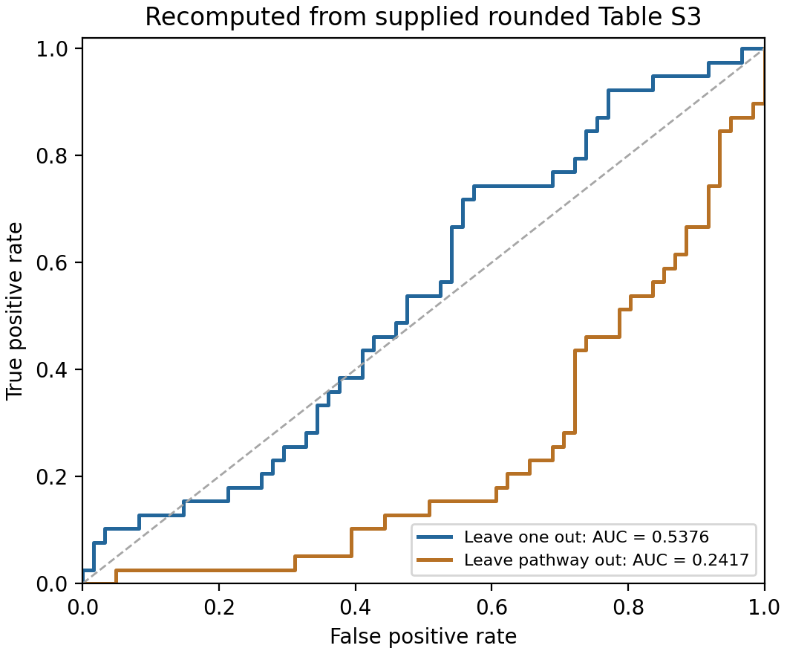

# Enzyme Assembly Recompute

[English](README.en.md) · [生物学背景](docs/biological_background.md) · [使用文档](docs/usage.md) · [方法](docs/methods.md) · [可复现性](REPRODUCIBILITY.md)

**面向无膜细胞器研究，检验代谢蛋白的序列特征能否预测其组装标签的Python分析工具。** 程序读取已有的蛋白特征表和阳性/阴性标签，用监督机器学习建立分类模型，再通过交叉验证和统计检验评估这些特征的预测信息。

## 研究背景与目标

无膜细胞器是细胞内没有脂质膜包裹、能够富集特定分子并组织生化过程的结构。液–液相分离（liquid–liquid phase separation，LLPS）是部分此类结构形成的物理机制：蛋白质或核酸等组分形成与稀相共存的富集相。代谢酶也可在特定条件下形成或参与细胞内组装体，因此其组装规律与无膜细胞器研究相关。相关概念、实验例子和文献见[生物学背景](docs/biological_background.md)。

本项目检验一个具体问题：**在给定数据和验证规则下，蛋白长度、电荷、低复杂度、无序倾向等14项预先计算的序列特征，能否区分被标注为组装阳性和组装阴性的代谢蛋白？**

| 项目 | 本程序中的含义 |
|---|---|
| 一个样本 | 一个蛋白条目；所附100个条目不是100种无膜细胞器或100种组装方式 |
| 输入特征 | 每个蛋白的14项数值描述；不是14种酶，也不是无膜细胞器本身的序列 |
| 阳性标签 | 来源材料标注的组装阳性，涵盖LLPS、丝状体、淀粉样组装和寡聚体；可能包括组装体的参与成分 |
| 阴性标签 | 来源材料标注的组装阴性；不代表该蛋白在所有条件下都不能组装 |
| 主要输出 | 未参与对应模型训练的蛋白预测分数、ROC AUC、置换p值及条件性Bootstrap区间 |
| 结果用途 | 检查这组特征对这些参考标签的预测信息，为后续特征改进和实验设计提供依据 |

**当前任务是组装标签分类。** 所附阳性类别涵盖多种物理状态，不能统一等同于LLPS或已确认的无膜细胞器。模型分数也不能直接解释为细胞内LLPS发生概率。该工作流从特征CSV开始，不生成蛋白序列特征、分子结构或MD轨迹，也不计算组装体的催化功能或代谢通量。

参考数据包含100个蛋白条目、14项特征、39个阳性和61个阴性。特征保留来源手稿补充表S3的三位小数显示值。当前重算结果与来源手稿报告值不完全相同，详见[可复现性说明](REPRODUCIBILITY.md)。

## 分析流程

1. **读取特征和标签。** 检查输入列、样本数量、标签一致性、缺失值及分组信息。
2. **训练分类模型。** 使用L2正则化逻辑回归，学习14项特征与参考标签之间的统计关系；每折标准化参数只由训练集估计。
3. **检验留出预测。** 留一法每轮用其余99个蛋白训练，给被留出的蛋白打分，汇总100个折外分数计算AUC；同时可按整条通路留出验证。
4. **评估统计证据。** 打乱标签并重新运行训练流程以计算置换p值；对固定折外标签—分数记录做分层配对Bootstrap，估计条件性区间。
5. **导出与复核。** 保存预测、模型参数和静态图；支持逐项重构单个蛋白分数，并提供通路聚合、单特征检验及多重比较校正。

模型训练后得到的是标准化参数、截距和特征权重；验证结果反映它们对留出样本的表现。方法公式及统计约定见[方法文档](docs/methods.md)。

## 安装

支持环境：Python 3.12。主要依赖为NumPy、SciPy和Matplotlib。本项目从源代码目录运行。

从GitHub获取完整仓库，或解压完整项目包，在**同时包含`README.md`、`run_analysis.py`、`configs/`和`data/`的项目根目录**打开终端。下文的环境路径和文件查看命令均以此目录为起点。

### 1. 确认Python版本并创建项目环境

```bash
python3 --version
python3 -m venv .venv
./.venv/bin/python --version
```

第一条检查用于创建环境的Python版本，应为3.12系列；第二条在当前项目中创建`.venv/`，隔离本项目的依赖；第三条确认环境中的解释器可以启动。环境只需在当前机器的当前项目位置创建一次，后续运行可直接使用。

### 2. 在该环境中安装并检查依赖

```bash
./.venv/bin/python -m pip install --upgrade pip
./.venv/bin/python -m pip install -r requirements-tested.txt
./.venv/bin/python -m pip check
```

升级pip用于改善安装工具兼容性；`-r requirements-tested.txt`按仓库记录的固定版本安装计算依赖；`pip check`检查安装包之间的依赖要求是否满足。最后一条正常输出应包含`No broken requirements found.`。首次安装需要能够访问Python包源。

`requirements-tested.txt`是复核参考数值时使用的依赖文件；`requirements.txt`给出较宽的版本范围，用于其他环境的兼容性探索。选择不同环境时，应保留生成的`environment.json`用于追踪版本。

正文使用Linux、WSL及macOS的解释器路径。Windows原生PowerShell的对应命令，以及Ubuntu缺少venv组件时的处理，见[安装文档](docs/installation.md)。`.venv/`由每位使用者在本地创建，不随仓库分发。

## 快速开始

下面按“输入检查 → 快速试运行 → 查看输出 → 完整参考运行 → 数值复核 → 单蛋白解释”的顺序操作。安装完成后，从第1步开始；第7步是重复计算时的可选操作。

先理解分析命令的组成：

| 部分 | 含义 |
|---|---|
| `./.venv/bin/python` | 使用当前项目环境中的Python，确保加载该环境的依赖 |
| `run_analysis.py` | 执行本项目的分析入口脚本 |
| `--config configs/quick.json` | 从指定JSON文件读取输入位置、模型设置、重采样次数和输出位置 |
| `--check-only` | 只执行输入与配置检查，通过后退出，不训练模型 |

本教程直接指定解释器路径，因此不要求先激活环境。如果已使用`source .venv/bin/activate`激活同一环境，`python`也可调用它；下文统一保留明确路径，避免混用环境。

### 第1步：检查配置和输入，确认可以开始计算

```bash
./.venv/bin/python run_analysis.py --config configs/quick.json --check-only
```

程序读取`configs/quick.json`，再读取其中指定的`data/analysis_input_100.csv`。它检查必要列、0/1标签、特征是否为有限数值、样本数量，以及留出验证后的训练集是否仍包含两个类别。

**为什么先做：** 在耗费时间训练前，先排除缺列、标签冲突和配置错误。此步骤不会生成分析结果目录，也不能替代对原始生物学注释的审查。

所附数据通过时，终端包含：

```text
Input OK: n=100, features=14, positive=39, negative=61, pathways=25
Input SHA256: 08d3fea1b0230201498ce470eeafaa04c35878d557c2ee2bb59f23e22158fba3
```

`n`是蛋白条目数，`features`是特征数；SHA256标识输入文件的具体字节。检查通过后执行第2步；若出现`ERROR:`，先按提示修正输入或配置。

### 第2步：运行快速配置，验证整条计算流程

```bash
./.venv/bin/python run_analysis.py --config configs/quick.json
```

与第1步相比，只去掉了`--check-only`，这次会实际训练模型并保存结果。默认输出到`results/quick/`，目录由程序创建，首次运行无需手动建立。

快速配置仍使用全部100个蛋白和14项特征。程序会逐个留出蛋白，重新拟合标准化与逻辑回归，得到100个折外分数，再计算AUC；同时执行配置中启用的通路留出、通路聚合和特征检验。随后进行10次完整标签置换和50次固定折外记录的条件性Bootstrap。

**为什么先少量重采样：** 用较短的试运行确认读取、训练、统计和导出都能完成。快速配置不是只计算10个蛋白；“10次”指标签置换次数。它的p值和Bootstrap区间只适合检查流程，不作为默认参考统计值。

运行时会显示`Fitting 100 leave-one-out folds ...`、`LOO AUC = ...`及置换进度。正常结束后显示以`Complete:`开头的行。出现AUC只说明前面的拟合已完成，仍应执行第3步确认整次运行状态。

### 第3步：确认运行完成，再阅读结果报告

```bash
cat results/quick/run_status.json
cat results/quick/REPORT_结果解读.md
```

第一条查看运行状态，`status`应为`complete`；第二条在终端显示中文Markdown报告，集中列出AUC、p值、区间及其解释。`cat`是查看文件的命令，不会再次执行训练。

**为什么先看报告：** 报告将分散的CSV和JSON结果汇总起来，便于先判断运行是否完整、采用了什么统计约定。随后可按需要打开具体文件：

| 要查看的内容 | 快速运行对应文件 | 读取重点 |
|---|---|---|
| 每个蛋白的留出分数 | `results/quick/loo_predictions.csv` | `y_true`为参考标签，`probability`为对应折外分数 |
| AUC如何逐对得到 | `results/quick/auc_pairwise_comparisons.csv` | 阳性—阴性比较及每对的排序得分 |
| 每项特征的统计检验 | `results/quick/feature_tests.csv` | `kw_h`、`kw_p`及相应多重比较校正值 |
| 本次总体统计量 | `results/quick/summary.json` | 模型设置、AUC、置换尾概率和区间 |

**如何解释：** 留一法AUC衡量留出分数的跨类别排序，不是预测正确率。置换p值评价随机重排标签后是否常见同样高的AUC；条件性Bootstrap区间不包含模型重训的不确定性。分数针对来源组装标签，不是已校准的细胞内LLPS发生概率。

若状态是`failed`、`interrupted`或尚为`running`，当前文件可能不完整，应查看错误或进度信息。程序不自动续跑；处理问题后使用新的输出目录重新计算，方法见第7步。

### 第4步：运行完整参考配置，生成供复核的结果

```bash
./.venv/bin/python run_analysis.py --config configs/main.json
```

这次入口脚本不变，只将`--config`改为`configs/main.json`。两种配置的区别为：

| 设置 | `quick.json` | `main.json` |
|---|---:|---:|
| 蛋白/特征数量 | 100 / 14 | 100 / 14 |
| 默认L2强度lambda | 1 | 1 |
| 标签置换次数 | 10 | 300 |
| 条件性Bootstrap次数 | 50 | 200 |
| 默认输出目录 | `results/quick/` | `results/main/` |

**为什么换配置：** 在相同模型和输入下，增加重采样次数，生成与仓库冻结参考一致的分析设置。两种配置的原始留一分数及AUC应相同；置换p值和Bootstrap区间可因重复次数不同而变化。

`main.json`会从原始输入重新计算全部流程，不会读取`results/quick/`继续计算。因此第2步用于试运行，第4步可以独立执行；`main`只是默认参考配置名，正式研究所需的重采样次数仍应根据统计稳定性另行确定。

完成后，检查`results/main/run_status.json`中的`status`是否为`complete`，并阅读`results/main/REPORT_结果解读.md`。由于重采样次数更多，通常比快速配置耗时更长，具体时间取决于硬件和环境。

### 第5步：与仓库保存的数值基准进行比较

```bash
./.venv/bin/python tools/check_reference.py --results results/main
```

这个脚本读取刚生成的`results/main/`和仓库内的`examples/reference_run/`，不重新训练。它核对输入哈希、拟合设置、蛋白标识与标签、留出分数及AUC；随机种子和重复次数一致时，再比较置换统计量与Bootstrap区间。

**为什么需要：** 完成计算只说明流程结束；基准比较进一步检查当前环境和代码能否重算出保存的参考结果。正常输出的JSON中应包含`"status": "matched"`，以及实际完成比较的`checked`项目。

`matched`表示与本仓库冻结基准相符，不表示已经精确复现来源手稿。原文报告值与本项目结果的差异在下方“参考结果”和[可复现性说明](REPRODUCIBILITY.md)中保留。对快速配置运行同一检查时，重复次数不匹配的重采样项目会被跳过，因此应阅读`checked`列表。

### 第6步：拆解一个蛋白的分数，核对模型怎样计算

```bash
./.venv/bin/python explain_prediction.py --results results/main --gene PPAT
```

`--results`选择第4步生成的结果目录；`--gene PPAT`选择输入中的一个蛋白标识。脚本从`loo_fold_models.json`中找到PPAT被留出的那一轮，读取该轮训练得到的均值、标准差、权重和截距。

它依次复算：标准化值`(原始值−训练均值)/训练标准差`、每项贡献`权重×标准化值`，将全部贡献与截距相加，再经过sigmoid得到最终分数，并核对其是否与保存的折外分数一致。

**为什么这样核对：** 可以查看预测由哪些数值运算得到，确认留出蛋白使用的是对应训练折的参数。特征贡献解释的是模型计算，不等同于生物学因果效应。

命令会在同一结果目录中生成：

- `prediction_breakdown_PPAT.md`：逐步解释与特征贡献表。
- `prediction_breakdown_PPAT.csv`：可继续计算和核对的完整数值。

所附数据的参考PPAT分数约为`0.388356812013`。该步骤不重新进行留一训练、置换或Bootstrap。其他蛋白也可通过更改`--gene`分析，但必须存在于所选结果的留出模型中。

### 第7步（可选）：使用新目录重复计算，或并行执行置换

已有`results/main/`时，可以保留原结果，将新运行输出到另一目录：

```bash
./.venv/bin/python run_analysis.py --config configs/main.json --output results/run_02
```

`--output`覆盖配置中的输出位置，不改变输入和拟合设置。输出目录必须不存在或为空；这样可以避免新运行覆盖旧文件、混合不同运行的统计量。程序没有自动续跑功能。

如果需要两个进程并行执行标签置换，另选一个新目录：

```bash
./.venv/bin/python run_analysis.py --config configs/main.json --workers 2 --output results/run_parallel
```

`--workers 2`控制置换工作进程数，不启用GPU，也不代表两个交叉验证折；在相同环境、种子和配置下，应保持数值结果一致。进程数并非越多越快，应结合CPU和内存使用情况选择。

**后续命令必须读取同一次运行：** 若选择`results/run_parallel`，相应复核与解释命令为：

```bash
./.venv/bin/python tools/check_reference.py --results results/run_parallel
./.venv/bin/python explain_prediction.py --results results/run_parallel --gene PPAT
```

`run_analysis.py`、结果比较和分数解释是三个独立入口，通过结果目录衔接。它们的参数、配置字段和完整输出清单见[使用文档](docs/usage.md)。程序按仓库根目录解析相对配置、输入与输出路径；本页的`cat`等文件查看命令则按当前终端目录解析，因此操作时应保持位于项目根目录。

### 常见问题

| 现象 | 原因与处理 |
|---|---|
| `python: command not found` | 本页Linux/WSL命令用`python3`创建环境，随后直接调用`./.venv/bin/python`；无需依赖全局`python`别名 |
| `./.venv/bin/python`不存在 | 确认终端位于项目根目录，且已完成环境创建；Windows原生环境使用`.\.venv\Scripts\python.exe` |
| 创建环境时提示`ensurepip`不可用 | Ubuntu可能缺少匹配的venv组件；见[安装文档](docs/installation.md) |
| `ModuleNotFoundError` | 用本页同一个环境解释器执行`-m pip install -r requirements-tested.txt`，再运行`-m pip check` |
| 输出目录不是空目录 | 改用第7步的`--output`指定新目录；保留旧结果便于比较 |
| 找不到`summary.json`或`loo_fold_models.json` | 确认计算已经完成，并使`--results`与实际输出目录一致 |
| 复核提示输入或设置不同 | 当前结果不适用该冻结基准；检查`config_used.json`及输入来源，按对应设置解释结果 |

## Windows原生PowerShell的命令形式

在Windows原生PowerShell中，环境解释器位于`Scripts`目录。先确认本机`python`为3.12；若使用Python启动器，环境创建命令也可替换为`py -3.12 -m venv .venv`。

```powershell
python --version
python -m venv .venv
.\.venv\Scripts\python.exe -m pip install --upgrade pip
.\.venv\Scripts\python.exe -m pip install -r requirements-tested.txt
.\.venv\Scripts\python.exe -m pip check
```

安装后的计算顺序与上面相同，只替换解释器路径；使用`Get-Content -Encoding utf8`查看报告：

```powershell
.\.venv\Scripts\python.exe run_analysis.py --config configs/quick.json --check-only
.\.venv\Scripts\python.exe run_analysis.py --config configs/quick.json
Get-Content -Encoding utf8 results/quick/run_status.json
Get-Content -Encoding utf8 results/quick/REPORT_结果解读.md
.\.venv\Scripts\python.exe run_analysis.py --config configs/main.json
.\.venv\Scripts\python.exe tools/check_reference.py --results results/main
.\.venv\Scripts\python.exe explain_prediction.py --results results/main --gene PPAT
```

同样需要在快速运行完成后确认状态，再执行完整配置；完整配置完成后再执行结果复核。WSL终端属于Linux环境，应继续使用前面的`./.venv/bin/python`命令。

## 输入与输出

默认输入为`data/analysis_input_100.csv`，包含蛋白标识、分组、状态、0/1标签及14项数值特征。主模型只使用数值特征；基因名和通路编号用于索引或分组。

| 主要输出 | 内容 |
|---|---|
| `report.md`、`REPORT_结果解读.md` | 英文、中文运行报告 |
| `summary.json` | AUC、p值、区间和分析设定 |
| `loo_predictions.csv` | 每个样本的折外预测分数 |
| `loo_fold_models.json` | 每轮模型、标准化和留出索引 |
| `auc_pairwise_comparisons.csv` | 跨类别配对及排序得分 |
| `permutation_aucs.csv`、`permuted_labels.csv` | 置换统计量和实际标签 |
| `bootstrap_aucs.csv` | 条件性Bootstrap统计量 |
| `feature_tests.csv` | 单特征两组检验、状态组KW检验及本实现附加的BH校正 |
| `model_final.json` | 用全部输入另行拟合的模型；性能评价使用折外分数 |
| `environment.json`、`config_used.json` | 版本、哈希和运行配置 |
| `run_status.json` | `running`、`complete`、`failed`或`interrupted` |

[输入格式](docs/input_format.md) · [数据来源与标注限制](docs/data_sources.md)

## 参考结果

固定输入、`lambda=1`、种子20261111、300次置换、200次条件性Bootstrap：

| 指标 | 本项目参考值 | 来源手稿报告值 |
|---|---:|---:|
| 留一法ROC AUC | 0.5376208491 | 0.58 |
| 原始上尾置换比例 | 0.1133333333 | 未单独确认 |
| 上尾置换p（本项目加1校正） | 0.1162790698 | 0.073，校正规则未完整说明 |
| 条件性Bootstrap 95%区间 | 0.4240016814–0.6369482976 | 0.49–0.78，抽样算法未完整说明 |
| 留通路ROC AUC | 0.2416981925 | 0.45 |
| 通路聚合ROC AUC | 0.5769230769 | 0.60 |

这组参考结果显示当前特征和模型的留出区分能力有限，上尾置换检验未在0.05阈值下提供显著证据。该结果约束的是本数据、特征表示和验证方案，不能据此断言所有序列方法都无效，或确定组装由哪些环境因素驱动。

Bootstrap区间以固定折外分数为条件，不包含模型重训或通路级抽样的不确定性。置换按单个蛋白交换标签，交换性及组内依赖需要独立评估。参考数值适用于所附数据和明确记录的设置。



冻结数值及分数位于[参考运行目录](examples/reference_run/README.md)。

## 文档与项目结构

| 位置 | 内容 |
|---|---|
| [docs/biological_background.md](docs/biological_background.md) | 无膜细胞器、组装标签与本程序研究目标 |
| [docs/installation.md](docs/installation.md) | 环境安装 |
| [docs/usage.md](docs/usage.md) | CLI、配置与输出 |
| [docs/methods.md](docs/methods.md) | 模型及统计约定 |
| [docs/data_sources.md](docs/data_sources.md) | 来源、版本与已知数据问题 |
| [REPRODUCIBILITY.md](REPRODUCIBILITY.md) | 精确重算条件与验证边界 |
| `configs/` | 快速、正式配置及JSON Schema |
| `data/`、`reference/` | 输入表、来源元信息与手稿报告值 |
| `tests/`、`tools/` | 数值、流程和仓库检查 |

文档链接使用仓库相对路径。请在GitHub仓库中阅读，或保留完整目录后使用支持文件间跳转的Markdown阅读器；单独预览一份README可能无法打开其他文件。

## 开发与支持

```bash
./.venv/bin/python -m unittest discover -s tests -v
./.venv/bin/python tools/check_repository.py
```

第一条使用Python自带的`unittest`发现并执行`tests/`中的测试，用于检查数学计算与流程行为；第二条执行本项目的仓库检查脚本，核对文档文件链接、配置示例和输入校验值。它们用于开发与发布前验证，不替代前面的实际运行和结果复核。

问题报告使用仓库Issues，包含软件版本、完整命令、配置及复现步骤。贡献流程见[CONTRIBUTING.md](CONTRIBUTING.md)。GitHub Actions配置覆盖Ubuntu与Windows的Python 3.12；运行状态以对应提交的Actions记录为准。

## 引用与许可

来源记录与引用方式见[CITATION.md](CITATION.md)。本项目和来源数据的许可状态分别列于[LICENSE_NOTICE.md](LICENSE_NOTICE.md)；当前快照未指定开源许可证。
