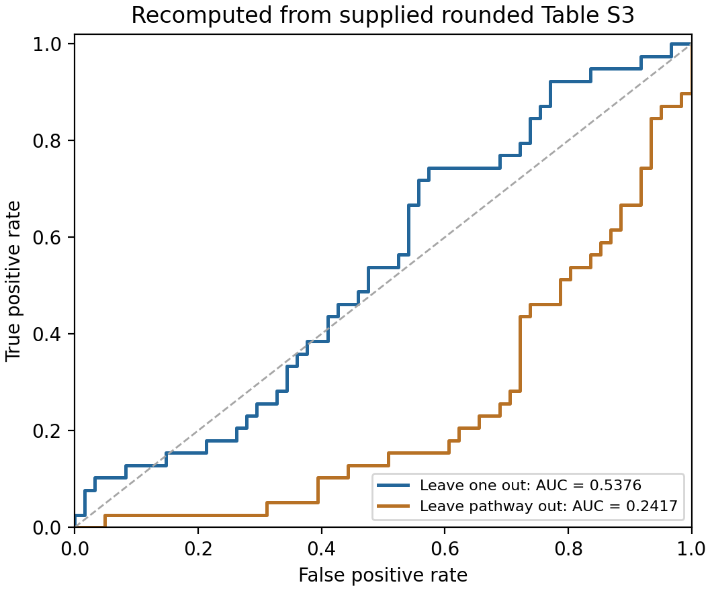
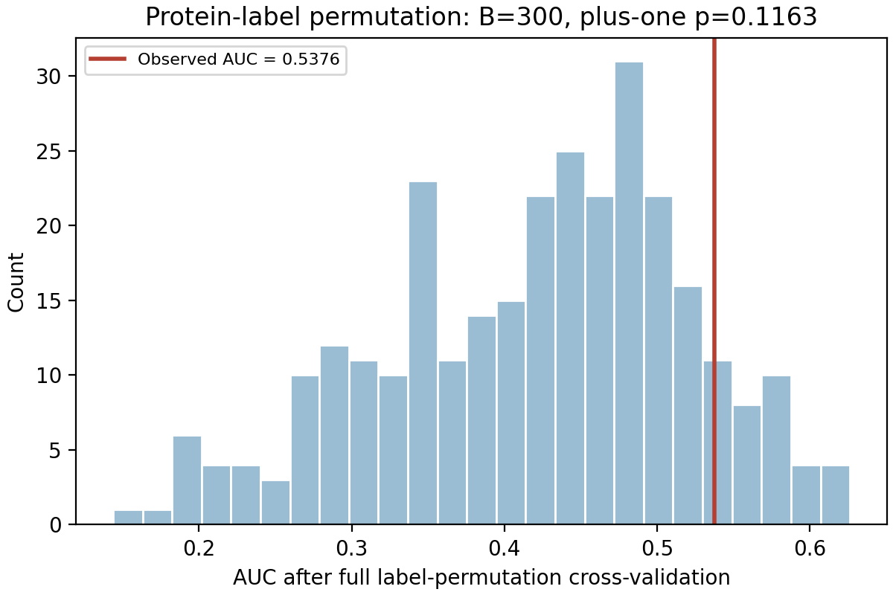

# Numerical reference

This directory contains curated outputs from the frozen version 0.1.0 reference run: 300 full-pipeline label permutations and 200 conditional bootstrap replicates. The input CSV bytes and numerical core are unchanged through version 0.2.2. Local absolute paths have been normalized for repository use.

| Metric | Value |
|---|---:|
| Leave-one-out ROC AUC | 0.537620849096259 |
| Cross-class comparisons | 1279 wins, 0 ties, 1100 losses; 2379 pairs |
| Inclusive upper-tail permutation count | 34 / 300 |
| Plus-one permutation p-value | 35 / 301 = 0.11627906976744186 |
| Conditional bootstrap 95% interval | 0.4240016814–0.6369482976 |
| Leave-pathway-out ROC AUC | 0.24169819251786465 |
| Pathway-aggregate ROC AUC | 0.5769230769230769 |
| Held-out PPAT probability | 0.3883568120130757 |

`summary.json` records precise values and conventions. `environment.json` records the original reference environment and code hashes. Those historical reporting-code hashes need not equal the current reporting code. The numerical regression checker compares values and input identity.

`paper_comparison.csv` is a curated presentation of manuscript and implementation metrics; the upstream p-value correction convention is unconfirmed.

Complete fold models and cross-class comparisons are generated in each new `results/` directory.

